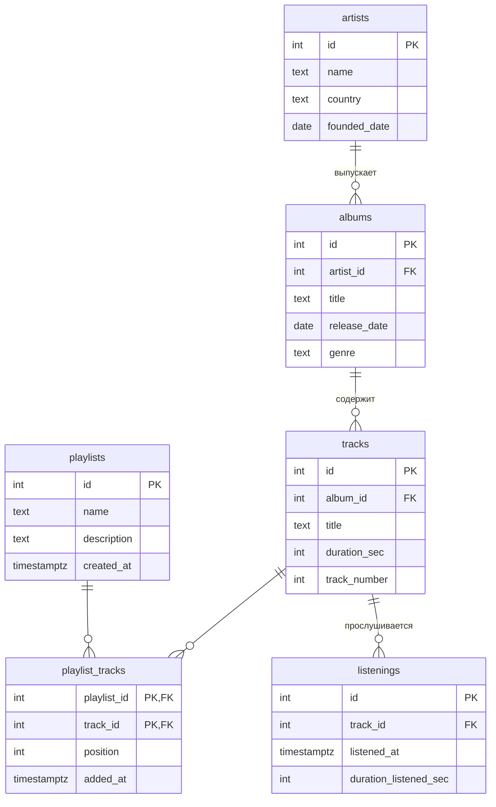

# Музыкальный стриминг

## Лабораторная работа 1

Тема №13. База данных для музыкального стримингового сервиса.

База хранит информацию об исполнителях, их альбомах и треках, пользовательских плейлистах и истории прослушиваний. Нужна для того, чтобы можно было формировать чарт недели по количеству прослушиваний и управлять плейлистами пользователей.

| | |
| --- | --- |
| Главная таблица | tracks |
| Связь N:M | Плейлист и трек через `playlist_tracks` |
| Бизнес-правило | Чарт недели по прослушиваниям |
| СУБД | PostgreSQL |

## Описание таблиц

- **artists** — исполнители (название, страна, дата основания)
- **albums** — альбомы (название, дата выхода, жанр, ссылка на исполнителя)
- **tracks** — треки (название, длительность, номер в альбоме, ссылка на альбом)
- **playlists** — плейлисты пользователей
- **playlist_tracks** — связующая таблица (какие треки в каких плейлистах и в каком порядке)
- **listenings** — прослушивания треков (время и длительность прослушивания). Нужна для построения чарта недели.

## ER-диаграмма

## Ограничения

| Ограничение | Таблица и колонки | Зачем |
| --- | --- | --- |
| UNIQUE | artists (name) | Нельзя иметь двух исполнителей с одинаковым именем |
| UNIQUE | albums (artist_id, title) | У одного исполнителя не может быть двух альбомов с одинаковым названием |
| UNIQUE | tracks (album_id, track_number) | В одном альбоме не может быть двух треков с одинаковым номером |
| UNIQUE | playlists (name) | Нельзя иметь два плейлиста с одинаковым названием |
| CHECK | tracks (duration_sec > 0) | Длительность трека не может быть нулевой или отрицательной |
| CHECK | tracks (track_number > 0) | Номер трека в альбоме должен быть положительным |
| CHECK | playlist_tracks (position > 0) | Позиция трека в плейлисте должна быть положительной |
| CHECK | albums (release_date <= CURRENT_DATE) | Дата выхода альбома не может быть в будущем |
| CHECK | listenings (duration_listened_sec > 0) | Длительность прослушивания должна быть положительной |

## Доп. задание 1: Нормализация

Если хранить все данные в одной таблице, она могла бы выглядеть так:

| artist_name | artist_country | album_title | album_genre | track_title | duration_sec | playlist_name | listened_at |
|-------------|----------------|-------------|-------------|-------------|--------------|---------------|-------------|
| Макс Корж | Беларусь | Животный мир | Hip-Hop | Время | 411 | Chill Vibes | 2026-10-01 10:15:00 |
| Макс Корж | Беларусь | Животный мир | Hip-Hop | Молодым | 308 | Chill Vibes | 2026-10-02 09:05:00 |
| Макс Корж | Беларусь | Животный мир | Hip-Hop | Уролог | 407 | Road Trip | 2026-10-03 21:00:00 |
| Smash Mouth | США | All Star Smash Hits | Pop | All Star | 319 | Workout Mix | 2026-10-01 10:15:00 |
| t.A.T.u | Россия | 200 по встречной | Eurodance | Нас не догонят | 224 | Party Starters | 2026-10-03 22:30:00 |

### Проблемы:
- Имя и страна исполнителя повторяются для каждого трека.
- Название и жанр альбома повторяются для всех треков одного альбома.
- Название плейлиста повторяется для каждого трека в нём.
- При изменении страны исполнителя или названия альбома пришлось бы править много строк.

### Как привели к 3НФ:
- Исполнители вынесены в таблицу `artists`.
- Альбомы вынесены в таблицу `albums` (связь 1:N с исполнителем).
- Треки вынесены в таблицу `tracks` (связь 1:N с альбомом).
- Плейлисты вынесены в таблицу `playlists`.
- Связь N:M между плейлистами и треками реализована через связующую таблицу `playlist_tracks`.
- Прослушивания вынесены в таблицу `listenings`.

Теперь изменение данных исполнителя или альбома делается в одном месте.

## Типы данных

- Для дат и времени используется `timestamptz` (учитывает часовой пояс).
- Длительности хранятся в `integer` (секунды).
- Обязательные поля помечены `NOT NULL`.
- Ограничения целостности заданы через `CHECK` и `UNIQUE`.

## Доп. задание 2:  Поведение при удалении

| Связь | ON DELETE | Причина |
|-------|-----------|---------|
| albums → artists | RESTRICT | Нельзя удалить исполнителя, пока у него есть альбомы |
| tracks → albums | CASCADE | Если удалили альбом — автоматически удаляются его треки |
| playlist_tracks → playlists | CASCADE | Если удалили плейлист — удаляются все связи с треками |
| playlist_tracks → tracks | CASCADE | Если удалили трек — он автоматически убирается из всех плейлистов |
| listenings → tracks | CASCADE | Если удалили трек — удаляется вся история его прослушиваний |

## Лабораторная работа 2

В файле `demo/lab2.sql` написано 12 запросов к базе музыкального стриминга.

### Реализованные запросы

| № | Вопрос | Что использовано |
|---|--------|------------------|
| 1 | Все треки с альбомом и исполнителем | JOIN (3 таблицы) |
| 2 | Количество треков в каждом альбоме | JOIN + GROUP BY |
| 3 | Альбомы с более чем одним треком | GROUP BY + HAVING |
| 4 | Треки без прослушиваний | LEFT JOIN + IS NULL (сироты) |
| 5 | Треки без прослушиваний (вариант) | LEFT JOIN + IS NULL |
| 6 | Треки из плейлиста «Chill Vibes» | Подзапрос (IN) |
| 7 | Исполнители с альбомами после 2020 года | Подзапрос (EXISTS) |
| 8 | Средняя длительность треков по жанрам | JOIN + GROUP BY + avg() |
| 9 | Самый длинный трек в каждом альбоме | Коррелированный подзапрос |
| 10 | Добавление нового прослушивания | INSERT + BEGIN/ROLLBACK |
| 11 | Увеличение длительности длинных треков | UPDATE + BEGIN/ROLLBACK |
| 12 | Удаление старых прослушиваний | DELETE + BEGIN/ROLLBACK |

### Соответствие чек-листу

- Есть запросы с `JOIN` (в том числе с 3 таблицами)
- Есть `GROUP BY` и `HAVING`
- Есть поиск «сирот» через `LEFT JOIN` + `IS NULL`
- Есть подзапросы (`IN`, `EXISTS`, коррелированный)
- Есть `INSERT`, `UPDATE` и `DELETE` с откатом транзакции
- Всего 12 запросов

## Доп. задание 1: CTE и оконные функции

#### Запрос 13. Топ-3 самых длинных трека в каждом жанре
Используется CTE (`WITH`) и оконная функция `ROW_NUMBER() OVER (PARTITION BY genre ORDER BY duration_sec DESC)`.
Показывает три самых длинных трека внутри каждого жанра.

#### Запрос 14. Накопительное количество прослушиваний по дням
Используется оконная функция `SUM(count(*)) OVER (ORDER BY day)`.
Показывает, как накапливается общее число прослушиваний день за днём.

## Доп. задание 1: CTE и оконные функции

#### Запрос 15. Статистика по жанрам
По каждому жанру считается:
- общее количество треков;
- количество длинных треков (> 300 сек);
- количество коротких треков (< 200 сек);
- процент длинных треков.

Используется `GROUP BY` и `count(*) FILTER (WHERE ...)`.

## Что сделано по лабам

| Лаба | Что сделано | Сценарий |
| --- | --- | --- |
| 1 | Создана схема, данные, ограничения, ER-диаграмма и нормализация | demo/lab1.sql |
| 2 | Написано 12 запросов (JOIN, GROUP BY, HAVING, подзапросы, сироты, INSERT/UPDATE/DELETE) | demo/lab2.sql |